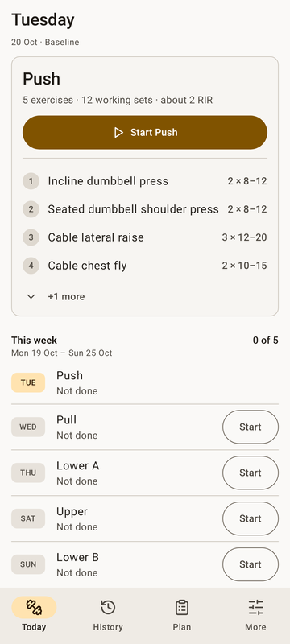
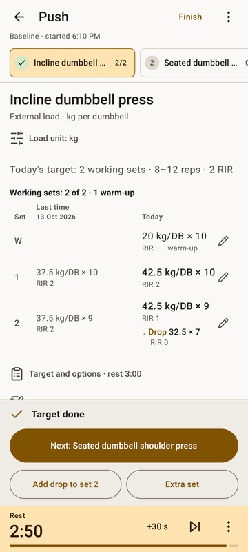
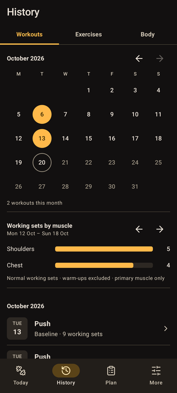
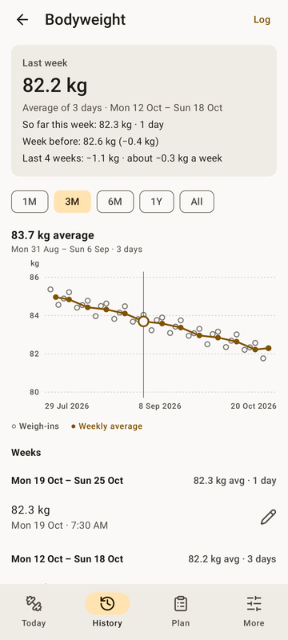
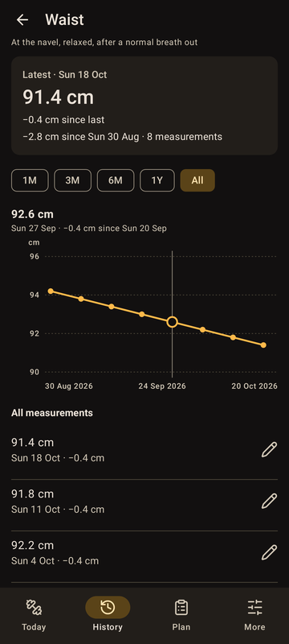
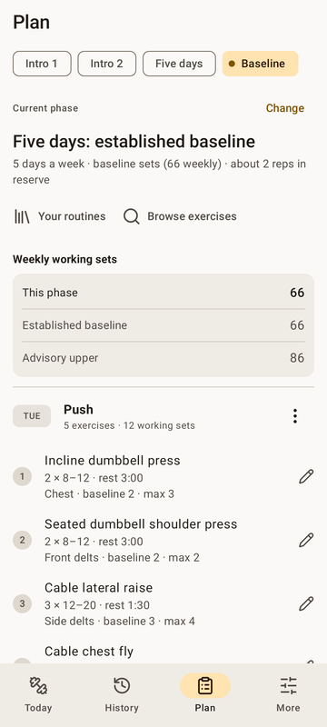

# Rebuild (the best workout tracker)

[](https://github.com/kidusm001/rebuild-android/actions/workflows/ci.yml)
[](https://github.com/kidusm001/rebuild-android/releases/latest)

**An offline strength-training logbook for Android.** Built with Kotlin and Jetpack Compose (Material 3). No
account, no backend, no analytics and no Internet permission; every workout lives in one transactional SQLite
snapshot on the phone.

<p>
  
  
  
  
  
  
</p>

## What it does

- **Set-by-set logging.** Every set sits beside the same set last time, in the same unit. Drops are part of their
  set, and rest-pause sets are one set. Loads can be kg, lb or plates per stack, and are never converted.
- **A weekly plan.** Phases and routines on a Monday-to-Sunday checklist, with your own routine library, flexible
  extra workouts, and timed, distance and cardio exercises with a stopwatch that survives process death.
- **Rest between sets.** The countdown survives leaving the app, as a countdown notification and a
  picture-in-picture timer.
- **Progress you can trust.** Records are sets actually lifted, never an estimated max. Bodyweight shows honest
  weekly averages that break over missed weeks. Weekly circumference checks are kept per site. Every chart can be
  touched to read any point.
- **Backups.** Versioned JSON files through Android's file picker, validated and previewed before any restore.

The full manual is in [docs/user-guide.md](docs/user-guide.md), and why each screen looks the way it does is in
[DESIGN.md](DESIGN.md).

## Engineering

- **Data safety first.** The app is used daily with real history, so every release installs over the last and keeps
  everything:
  - The codec is strict, with versioned schemas and per-version field gating.
  - Migrations only ever add.
  - Snapshots are committed in SQLite transactions.
  - Before each release, real database snapshots from earlier versions are re-opened and compared record by record.
  - The release workflow refuses to publish an APK signed with any key but the one already on the phone.
- **A pure core.** State changes are one pure function, `StateChanges.apply(state, action)`, over an immutable
  `AppState`, so domain behaviour is tested without Android.
- **Measured performance.** Tab switches stuttered, so they were profiled with Perfetto and Compose composition
  tracing, then fixed at the cause: keep-alive tabs, a remembered screen environment and a release build with
  baseline profiles. Main-thread work per switch fell from about 193 ms to 40 ms, and the first History visit from
  about 190 ms to 22 ms. The method and numbers are in [docs/performance.md](docs/performance.md).
- **Accessible by default:**
  - Every control is at least 48 dp, and contrast is checked at WCAG AA in tests.
  - Charts are sliders for TalkBack.
  - Values never wrap apart at 200% text.
  - Layouts adapt to landscape and to tablets with a navigation rail.
- **Tested at three levels:**
  - About 340 JVM tests, covering the domain, the codec, migrations and Robolectric UI.
  - A Robolectric screenshot tour of every main screen in light, dark, 200% text and landscape.
  - About 130 instrumented tests, on API 33 and 34 emulators in CI, with real input, the keyboard, rotation, process
    recreation and the accessibility tree; on API 34 they add AccessibilityValidator checks.

| Package | What's in it |
| --- | --- |
| `domain` | Models, the week, set groups, body and progress calculations |
| `data` | The reducer, codec and validation, migrations, the repository and SQLite persistence |
| `ui` | Compose screens and components, charts and the theme |
| `platform` | Rest alarms and notifications, the stopwatch clock, and backups |

## Build and run

You need JDK 21, the Android SDK (platform 35, build-tools 35.0.0) and the Gradle 8.13 wrapper in the repository. The
app runs on Android 8.0 (API 26) and later.

```sh
./gradlew :app:testDebugUnitTest :app:lintRelease :app:assembleRelease
./gradlew :app:connectedDebugAndroidTest   # with an emulator running
REBUILD_SCREENS=build/screens ./gradlew :app:testDebugUnitTest --tests 'com.rebuild.ui.ScreenshotHarness'
```

Install from a [release](https://github.com/kidusm001/rebuild-android/releases) with Android Files, or with
`adb install -r rebuild-<version>.apk`. **Never uninstall to work around an install error: that deletes the app's
data.** Export a backup first.

## CI/CD

- **[CI](.github/workflows/ci.yml)** runs on every push and pull request:
  - unit tests with the screenshot tour, lint and a release build;
  - the instrumented suite on API 33 and API 34 emulators, the second with AccessibilityValidator checks.

  Test results, screenshots and the APK are attached to each run.
- **[Release](.github/workflows/release.yml)** is continuous delivery. After CI passes on `main`, if `versionName`
  has no release yet:
  1. it builds and signs the APK with the app's key;
  2. verifies the certificate;
  3. tags the commit;
  4. publishes the APK and its SHA-256 as a GitHub Release, with notes from `docs/releases/`.

  A merge without a version bump releases nothing.

Setup is in [docs/ci.md](docs/ci.md). Version history is in [CHANGELOG.md](CHANGELOG.md).
