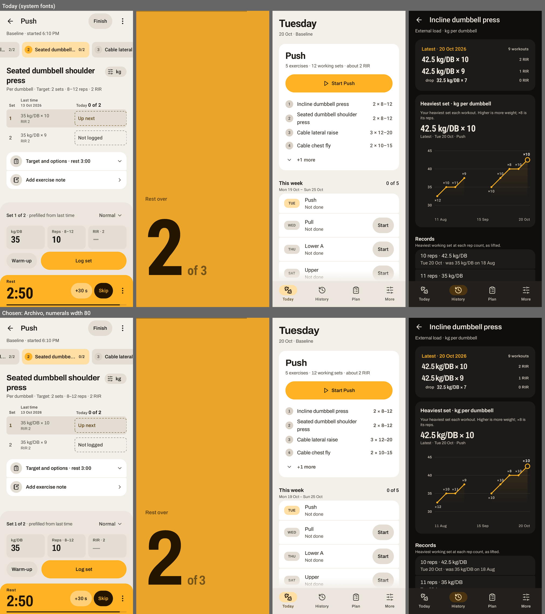

# App fonts: decision

Supersedes [../numerals-font/decision.md](../numerals-font/decision.md), which
assumed words stayed on the phone's font. The owner decided Rebuild bundles its
own fonts for all text, because the device's global font (One UI's on the Galaxy
A71) mixed with the app's design looks messy.

## Decision

**Archivo for everything** (Omnibus-Type, SIL OFL), one family on its width axis:

| Role | Family | `wdth` | `wght` | Notes |
| --- | --- | --- | --- | --- |
| Words (every text style) | Archivo | 100 | 400 / 500 / 600 / 700 | Same width as Roboto (99%); every 200% screen holds |
| Numerals (`Numerals`, display styles, ledger values) | Archivo | **80** | 700 | 97–100% of today's width; `tnum` on every numeral style |

**Runner-up: Roboto Flex** (words wdth 100, numerals wdth 72 opsz 36 wght 700).
It wins only if exercise names in **Cyrillic or Greek** must render in the app's
own face, because Archivo is Latin only (those scripts fall back to the system
font, as Amharic always does).

`archivo-w80` was the final pick of all four critics. The platform critic
preferred `wdth 78` for extra margin; the visual and UX critics preferred 80, and
the UX critic confirmed `wdth 80` holds every 200% screen and is the only set
that keeps "42.5 kg/DB × 10" on one line in the logged-set chip.

## How we got here

1. **Research.** [competitors.md](competitors.md): lifting apps keep type
   invisible (system fonts, or Inter, DM Sans, Figtree on their sites). Brands
   that care set numbers in a condensed or DIN face (WHOOP: DINPro for numbers).
   Condensed numerals from the same family's width axis is open space.
   [curator-candidates.md](curator-candidates.md): ten measured pairings.
2. **Round 1.** [brief](brief-round1.md). 13 sets rendered on the real app
   (Robolectric harness, light, dark, 200% text) and judged by four Opus critics:
   [UX](review-r1-ux.md), [visual](review-r1-visual.md),
   [platform](review-r1-platform.md), [product](review-r1-product.md).
   Archivo was the only set in every top 3. Sheets: [round1/](round1/).
3. **Round 2.** [brief](brief-round2.md). Six finalists, including Archivo
   numerals at wdth 75/700, 80/700 and 75/800, a confusable-digit glance sheet
   with a blurred view, Amharic beside each face and a DIN reference column
   ([round2/glance.png](round2/glance.png)). Reviews:
   [UX](review-r2-ux.md), [visual](review-r2-visual.md),
   [platform](review-r2-platform.md), [product](review-r2-product.md).

Why Archivo: a plain, sturdy grotesque that reads "direct" without going sporty;
words and numerals come from one design, so they match; its digits read as a
grotesque, not DIN, so it doesn't drift toward WHOOP; it has the most 200%
headroom of the characterful options; one variable file is small (about 64 KB
deflated as shipped, per the platform critic).

Rejected: Google Sans Flex (reads as Pixel UI), Mona Sans (GitHub's face), Fira
(words 104% wide, wraps at 200%), Roboto / Roboto Flex (no gain in character),
Sofia and Nunito Sans (too light or small), Instrument Sans (missing glyphs),
Asap (colon jams), Atkinson + Fira Condensed (two voices), Noto Sans (reflows).
The heavier `wdth 75 / 800` numerals crowd "42.5kg" and look like a sports stat
sheet.

## Must-fix when implementing

1. **Space between number and unit.** In Archivo's numerals, "42.5kg/DB" nearly
   touches. Widen the space and no-break space in the numerals font to about
   0.40 of a digit (from about 0.30), or add about 0.01 em tracking to the ledger
   style. Check the space around `×`.
2. **Vertical centring.** Archivo sits lower than Roboto in the rest-end sweep
   and the alarm bar; recentre those (line-height trim or alignment).
3. **Glyphs Archivo lacks:** `↳` (drops and pauses) and `●` `○` should be drawn as
   vector icons or shapes so they don't fall back to a system font.
4. **Licence.** Ship `OFL.txt` in `assets/`: release `shrinkResources` already
   strips unreferenced raw resources (it strips the Lucide licence today).
5. **Shipping form.** One variable `Archivo[wdth,wght]` subset to Latin, Latin-1
   and Latin Extended-A with `kern`, `tnum`, `lnum`, `case` kept, loaded with
   `FontVariation.Settings`; or static instances if Robolectric doesn't honour
   variation settings. Check the harness screenshots match these static renders.
6. **Tests.** Every text style resolves to Archivo; every numeral style has
   `tnum`; `0:00`–`9:59` all measure the same width; the font covers every
   character the UI uses.
7. **Logged-set chip.** It has about 1 dp spare at `wdth 80`: test
   "107.5 kg/DB × 12" and keep "× 12" together.
8. **Optional:** try the 32 sp headline at weight 650.
9. **On the A71**: the countdown in daylight (if it reads light, raise only the
   countdown to 750–800), small labels on dark, an Amharic name beside a title,
   and that Samsung's font no longer leaks into dialogs, notifications or
   picture-in-picture.
10. Update DESIGN.md "Type", and the `Numerals` and typography comments in
    `Theme.kt`.

## Separate, pre-existing

At 200% text, the History detail stat tiles cut their labels to "Minute",
"Workin" and "Exercis" with today's fonts as well. That's a layout bug for its
own fix, not part of the font change.

## Implementation notes

- The experiment's font-swap hooks were removed; `scripts/fonts/build_archivo.py`
  builds the shipped files, and `FontTest` guards them.
- **Notifications stay on system fonts.** The notification shade inflates our
  layouts in another process and can't load app font resources: on the API 34
  emulator, `@font/archivo_numerals` silently fell back to regular-width Roboto
  Bold, wider than the condensed face used before. The layouts keep
  `sans-serif-condensed` (now with `tnum`) and the system text styles.
- Android 14+ puts U+202F (narrow no-break space) before AM/PM. Archivo lacks it,
  so the build maps it to Archivo's thin space, plus U+200B (zero width); the
  platform critic's after-check caught this.
- After-check: all four critics said ship ([UX](review-after-ux.md),
  [visual](review-after-visual.md), [product](review-after-product.md),
  [platform](review-after-platform.md), whose one blocker, U+202F, is fixed).
  They accepted the logged chip wrapping "42.5 kg/DB" / "× 10", which matches
  today's fonts.
- The scratchpad paths in the briefs held the full-size renders during the study;
  the sheets in `round1/`, `round2/` and `after/` are the kept evidence (PNGs
  reduced to 256 colours to keep the repository small).
